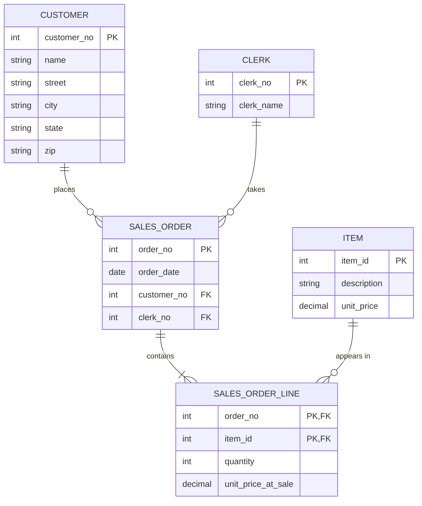

# Case 1: Retail sales orders — from one flat list to 3NF

**Starting point.** A store keeps every sale in a single list: customer number, name and address; sales order number and date; the clerk who took the order; the item, its description and unit price; quantity; and total sales.

**Goal.** Remove repetition and update anomalies, then implement the model.

## 1. Conceptual: find the entities

Reading the list, four things have their own identity: **customers**, **items**, **clerks** and **orders**. An order holds several items, so there is also an **order line** (order × item, with a quantity).

## 2. First normal form (1NF): atomic values, one value per cell

- The address was one field, so split it into `street`, `city`, `state`, `zip`. You can't filter by city otherwise.
- Each order line becomes its own row instead of a list of items in one cell.

| order_no | order_date | cust_no | cust_name | street | city | state | zip | clerk_no | clerk_name | item_id | item_desc | unit_price | qty |
|---|---|---|---|---|---|---|---|---|---|---|---|---|---|
| 101 | 2025-09-05 | 1 | Ava Patel | 12 Elm St | Tempe | AZ | 85281 | 1001 | Leo Grant | 10 | Oats | 4.50 | 2 |
| 101 | 2025-09-05 | 1 | Ava Patel | 12 Elm St | Tempe | AZ | 85281 | 1001 | Leo Grant | 11 | Milk | 3.20 | 1 |
| 102 | 2025-09-06 | 2 | Sam Ruiz | 7 Oak Ave | Mesa | AZ | 85201 | 1002 | Mia Chen | 10 | Oats | 4.50 | 3 |

The key is (`order_no`, `item_id`), but notice how often the customer and clerk details repeat.

## 3. Second normal form (2NF): no partial dependencies

With a composite key (`order_no`, `item_id`), every non-key column must depend on **both** parts:
- `item_desc` and `unit_price` depend on `item_id` alone, so they move to **Item**.
- `order_date`, the customer and the clerk depend on `order_no` alone, so they move to **SalesOrder**.
- Only `qty` depends on both parts, so it stays in **SalesOrderLine**.

## 4. Third normal form (3NF): no transitive dependencies

In **SalesOrder**, `cust_name` and the address depend on `cust_no`, not on the order, and `clerk_name` depends on `clerk_no`. Moving those out gives **Customer** and **Clerk**.

`total sales` is not stored: it is **derived** (`SUM(qty * unit_price)`), and storing it would let it drift out of sync.

## Final model

DDL and sample data: [`01_retail_orders.sql`](01_retail_orders.sql).

## Review notes (compared with my original workbook)

- My first 3NF draft kept `quantity` on **Orders** and added a separate *Sales* table of (item, order, customer). Quantity belongs to the **order line**: one order can have several items with different quantities. The customer is already on the order, so repeating it per line is redundant.
- I added `unit_price_at_sale` to the line. Item prices change over time, and an old order must keep the price it was sold at. This is a deliberate, documented exception to "store each fact once".
