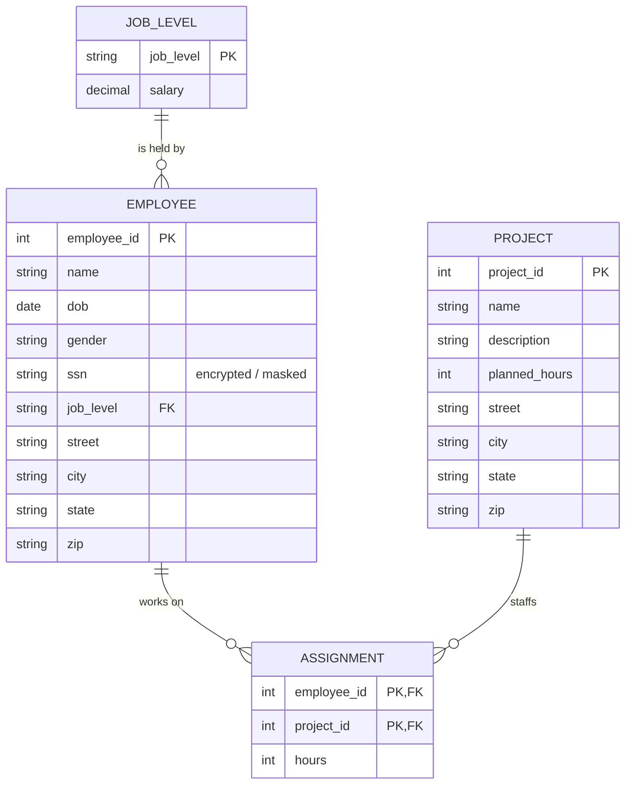

# Case 2: Projects and employee assignments — from one sheet to 3NF

**Starting point.** One spreadsheet row per *employee on a project*: project name, description, total project hours and project address, followed by the employee's name, date of birth, gender, job level, SSN, salary and home address, plus the hours that employee spends on that project.

| project | description | project_hours | project_address | employee | dob | gender | job_level | salary | employee_address | emp_hours |
|---|---|---|---|---|---|---|---|---|---|---|
| Reporting | Patient report analysis | 1000 | 100 Main St, Poway, CA 92064 | Nina Shah | 1985-01-01 | F | Mid Level | 50000 | 9 Lake Rd, Poway, CA 92064 | 100 |
| Reporting | Patient report analysis | 1000 | 100 Main St, Poway, CA 92064 | Tom Reyes | 1985-01-02 | M | Sr Level | 60000 | 4 Hill St, San Diego, CA 92128 | 75 |
| ETL | Load data to the DWH | 500 | 100 Main St, Poway, CA 92064 | Nina Shah | 1985-01-01 | F | Mid Level | 50000 | 9 Lake Rd, Poway, CA 92064 | 50 |

**Problems:** project details repeat for every employee on it, and employee details repeat for every project. Changing an employee's salary means editing several rows, and missing one leaves the data inconsistent.

## 1. Conceptual

Three things: **Employee**, **Project**, and the **Assignment** linking them. It's many-to-many: an employee works on several projects, and a project has several employees.

## 2. 1NF

- Split both addresses into `street`, `city`, `state` and `zip`.
- Give employees a surrogate `employee_id`. Names aren't unique, and the SSN is sensitive, so it shouldn't be used as a key that gets copied into other tables.
- Give projects a `project_id`.

## 3. 2NF

The key of the sheet is (`employee_id`, `project_id`).
- Project columns depend only on `project_id`, so they move to **Project**.
- Employee columns depend only on `employee_id`, so they move to **Employee**.
- Only `emp_hours` depends on both, so it stays in **Assignment**.

## 4. 3NF

In **Employee**, `salary` is determined by `job_level` (Mid Level = 50000, Sr Level = 60000 in the data), not by the employee. That's a transitive dependency: employee → job_level → salary. Moving it out gives **JobLevel**. A pay change for a level is now one update.

## Final model

DDL and sample data: [`02_projects_employees.sql`](02_projects_employees.sql).

## Review notes (compared with my original workbook)

- My draft used an `Assignment ID` described as "employee ID + project ID". The cleaner design is a **composite primary key** (`employee_id`, `project_id`), which also stops the same employee being assigned to a project twice.
- **The SSN is personal data:** keep it out of keys, restrict access, and encrypt or mask it. The original sheet already masked it as `XXX-XX-XXXX`.
- **Is salary really per job level?** If salaries can differ within a level, keep `salary` on Employee and treat the level's salary as a band (min/max). The data has to confirm the dependency before you normalize on it.
- **Project hours vs assignment hours:** `planned_hours` on Project can be checked against `SUM(Assignment.hours)`. That's useful for reporting over- or under-allocated projects.
